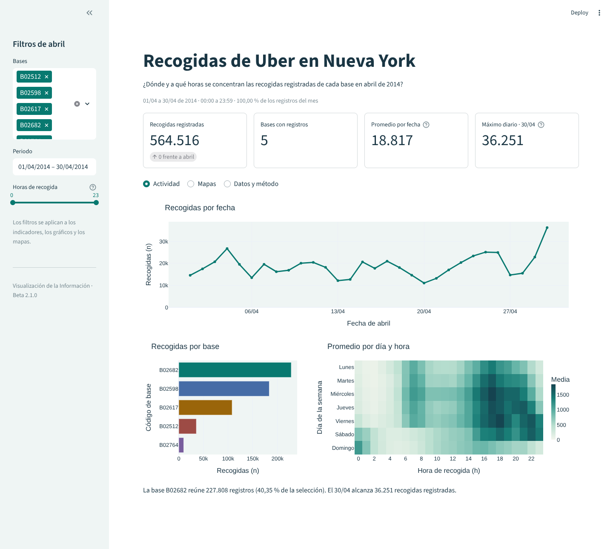

# Recogidas de Uber en Nueva York
Dashboard del Hito 1 de Visualización de la Información. Beta 2.1.0, abril de 2014.

**Pregunta.** ¿Dónde y a qué horas se concentran las recogidas registradas de cada base en abril de 2014?

Pensado para analistas de movilidad que quieren comparar la actividad registrada por base, fecha y hora. El archivo describe puntos de recogida. Para identificar el destino o reconstruir un trayecto harían falta otros datos.

**Integrantes.** Joaquín Domke, Renato Friz y Elías Nazal.  
**App pública.** [Abrir el dashboard de Uber en Streamlit](https://eliasnazal3-uber-nyc-abril-2014-app-q0klbv.streamlit.app/)



## Uso

1. Elige las bases, el periodo de abril y el intervalo horario. Los tres filtros actúan juntos en los indicadores, los gráficos y la tabla.
2. En **Actividad**, mira la línea diaria, las barras por base y el promedio por día de la semana y hora. Pasa el cursor por un gráfico para ver el valor de la selección.
3. En **Mapas**, alterna entre los puntos por base y la densidad y prueba el zoom. El fondo inicial incluye los límites de los distritos y las vías principales. El fondo detallado en línea necesita conexión al proveedor de cartografía. Para dibujar ambos mapas, el navegador necesita WebGL.
4. En **Datos y método**, consulta las validaciones del archivo completo y despliega la tabla paginada de las filas filtradas. Una selección sin filas muestra un aviso.

## Datos y cálculos

El CSV corregido del Certamen 2 está en `data/uber_abril_2014.csv.gz`. La app lee la copia comprimida directamente. Al descomprimirla se recupera el CSV original completo de 24.416.509 bytes, con suma SHA-256 `427b49d2f1b0335936d94359776b46d20d1a71de9caa4de9ad44e9918bf14c02`. También se admite la copia descomprimida con el nombre `data/uber_abril_2014.csv`. Los campos de origen son fecha y hora de recogida (`Date/Time`), latitud y longitud en grados (`Lat`, `Lon`) y código de la base (`Base`). Se siguió la decisión del notebook `Uber_Certamen2_Final_v3.ipynb` sobre las repeticiones y su zona espacial de referencia.

| Cálculo en abril completo | Resultado |
| --- | ---: |
| Filas válidas después de revisar fecha, base y coordenadas | 564.516 |
| Bases distintas con filas | 5 |
| Promedio por fecha = 564.516 ÷ 30, redondeado | 18.817 |
| Máximo de los conteos diarios, el 30 de abril | 36.251 |
| Registros de B02682 ÷ 564.516 × 100 | 227.808 / 564.516 = 40,35 % |
| Repeticiones adicionales de los cuatro campos, conservadas | 7.749 |
| Filas con coordenadas ausentes, en cero o fuera de los límites mundiales | 0 |

Cada fila cuenta como una recogida registrada. Dos filas idénticas pueden describir registros distintos o una duplicación de origen. Sin identificador de viaje, se conservan y se informa cuántas coinciden. Comprobar los límites mundiales tampoco demuestra que cada punto esté dentro del municipio.

El promedio diario incluye las fechas de la selección con cero registros. El perfil horario promedia cada combinación de día de semana y hora sobre las fechas de ese día presentes en el calendario elegido. El delta del primer indicador es el recuento filtrado menos las 564.516 filas válidas de abril. El porcentaje de cada base usa como denominador todos los registros de la selección.

Los indicadores y los tres gráficos de actividad usan todas las filas filtradas. Para los dos mapas se dibujan todas si hay hasta 10.000. Por encima de ese umbral, se eligen 10.000 con `random_state=42` después del filtrado. Ambas vistas usan la misma selección. La zona de referencia del análisis anterior comprende 40,71° a 40,80° de latitud y −74,01° a −73,95° de longitud. La intensidad suavizada de la densidad depende del radio y del zoom. No permite calcular demanda total ni un número de viajes por barrio.

## Ejecutar en el equipo

Desde la raíz que contiene `app.py`, con Python 3.12:

```bash
python -m pip install -r requirements.txt
python -m streamlit run app.py
```

Abre la dirección local que indica la terminal. Las librerías probadas están fijadas en `requirements.txt`. Para desplegar en Streamlit Community Cloud, selecciona el repositorio público del grupo, la rama `main`, el archivo `app.py` y Python 3.12. La configuración visual está en `.streamlit/config.toml`.

## Versión y continuidad

- Hito 1, etiqueta `v2.1.0-beta`. Tres filtros globales, cuatro indicadores y cinco vistas gráficas hechas con Plotly Express.
- [Plan propuesto hacia el Hito 2](docs/plan_hito2.md). Fecha de la entrega final según la pauta del examen: 3 de diciembre.
- La captura del README procede de la ejecución local de esta beta con los filtros iniciales.

## Procedencia

- Datos iniciales de las recogidas de abril publicados por FiveThirtyEight con información de la NYC Taxi & Limousine Commission. En la app se usa la copia corregida trabajada por el grupo. [FiveThirtyEight, Uber pickups in New York City](https://github.com/fivethirtyeight/uber-tlc-foil-response).
- Cartografía de referencia del fondo incluido. Los cinco límites distritales proceden de NYC Department of City Planning, copia histórica distribuida con GeoPandas. Las vías principales y secundarias corresponden a TIGER/Line 2014 de U.S. Census Bureau. Se reproyectaron y simplificaron las geometrías, y las vías se recortaron a la zona de Nueva York. Ambos créditos figuran en la app. [NYC Planning](https://www.nyc.gov/content/planning/pages/resources/datasets/borough-boundaries) · [Archivo histórico de distritos](https://github.com/geopandas/geopandas/blob/v0.14.4/geopandas/datasets/nybb_16a.zip) · [TIGER/Line, Nueva York](https://www2.census.gov/geo/tiger/TIGER2014/PRISECROADS/tl_2014_36_prisecroads.zip).
- Documentación de las herramientas. [Desplegar en Community Cloud](https://docs.streamlit.io/deploy/streamlit-community-cloud/deploy-your-app/deploy) · [Capas de mapas en Plotly](https://plotly.com/python/tile-map-layers/) · [Publicar una versión en GitHub](https://docs.github.com/en/repositories/releasing-projects-on-github/managing-releases-in-a-repository).
